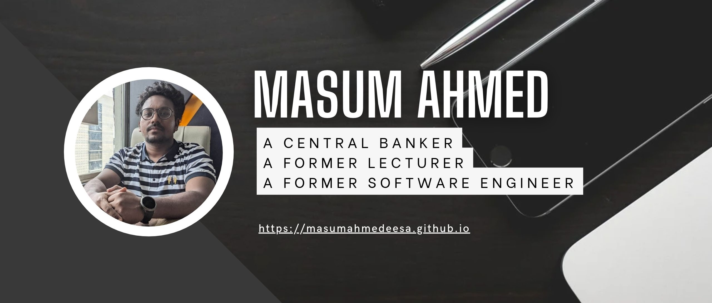
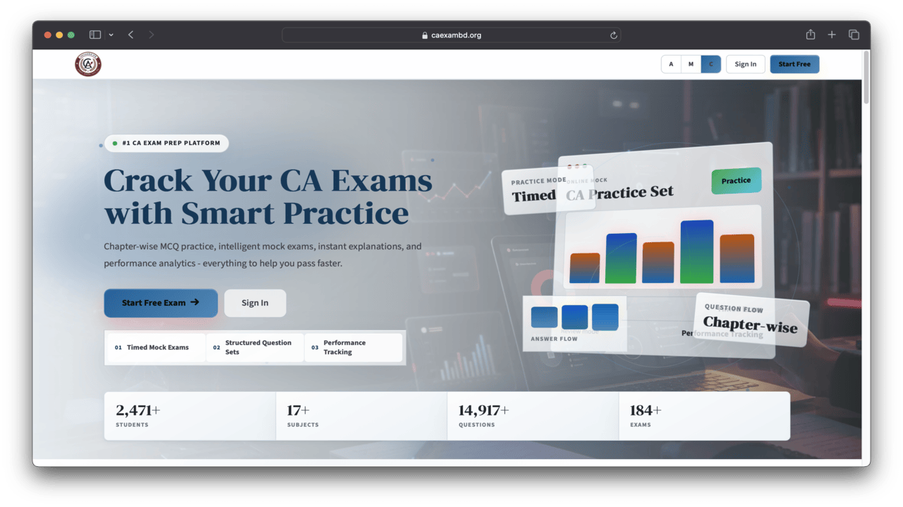
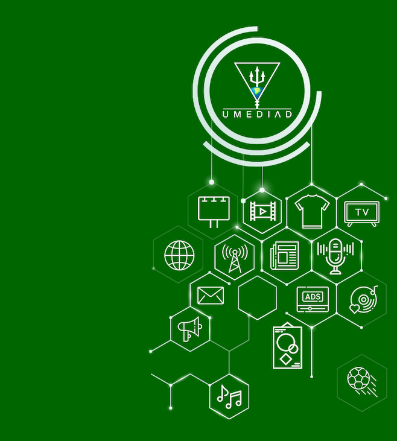
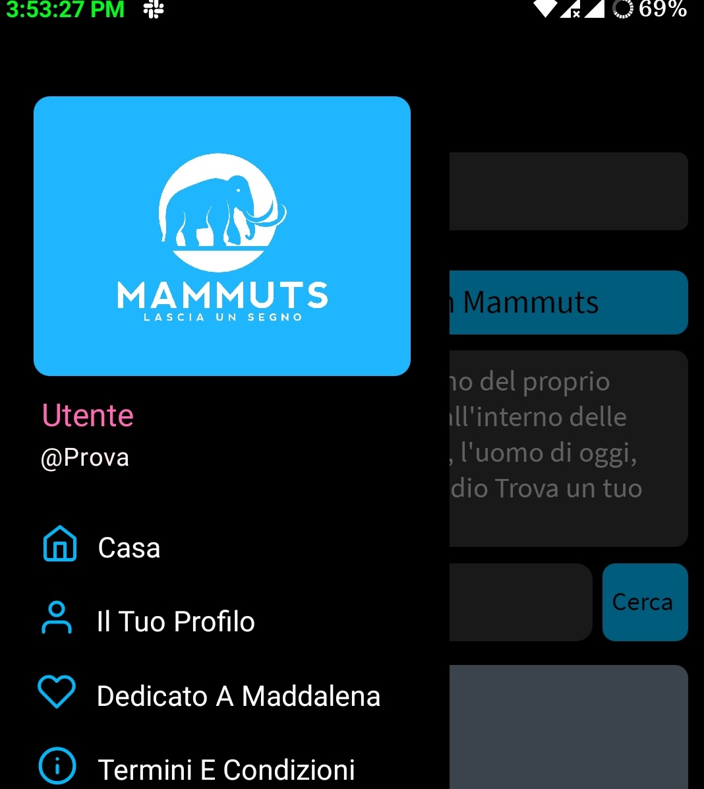
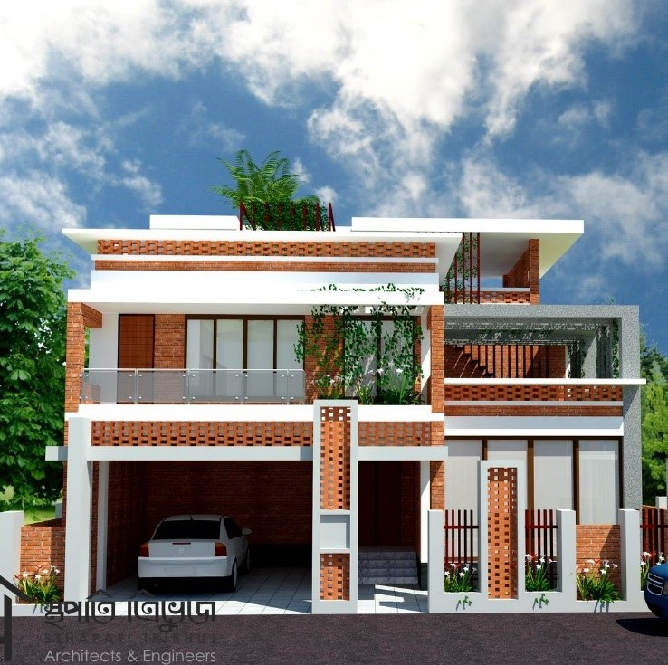
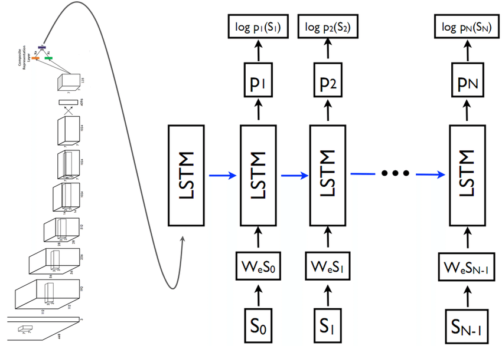

  

<h1>Hi, I am Masum Ahmed 👋</h1>

  <strong>Central Banker · Full Stack Developer · Open-Source Builder · Former Lecturer · Data Engineer</strong>

  
  
  
  

  <a href="#-about-me">About</a>
  ·
  <a href="#-professional-journey">Journey</a>
  ·
  <a href="#-selected-projects">Projects</a>
  ·
  <a href="#-skills">Skills</a>
  ·
  <a href="#-research">Research</a>
  ·
  <a href="#-connect">Connect</a>

---

## 🌿 About Me

I am a Software Engineer interested in **frontier technologies, human-centered products, open-source systems, and community-minded software**.

My work spans full-stack product development, learning platforms, e-commerce systems, real-time communication, admin automation, API design, UI engineering, and machine learning experiments. I enjoy building products that are not only technically sound, but also clear, maintainable, and meaningful to the people who use them.

> [!NOTE]
> Feel free to explore my interactive 3D portfolio at [masumahmedeesa.github.io](https://masumahmedeesa.github.io), where my profile, projects, skills, research, and experience are presented as a living digital tree.

<table>
  <tr>
    <td align="center"><strong>50k+</strong> Users served</td>
    <td align="center"><strong>2k+</strong> LMS learners</td>
    <td align="center"><strong>30+</strong> REST APIs</td>
    <td align="center"><strong>350+</strong> Online judge solutions</td>
  </tr>
</table>

---

## 🧭 Professional Journey

### Assistant Director (ICT) · Bangladesh Bank
**Full-time · Motijheel C/A, Dhaka-1000 · August 2025 - Present**

- Developing the RBS analytics platform on Oracle BI (OBIEE) 12c, building dashboards, pivot reports, and dynamic prompts that give supervisors clear, structured views of banking data.
- Turning supervisory data into reliable, stakeholder-ready reporting, bridging ICT and supervisory policy to support data-driven decisions.
- Working on eTransfer Posting and ePMS, Bangladesh Bank’s digital systems integrated with SAP, supporting rollout, user support, and data consistency across platforms.

### Full Stack Developer · CodexPro GmbH
**Part-time · Berlin, Germany · January 2023 - August 2025**

- Collaborated with UX designers to build reusable, custom, and 3D UI components using raw CSS and Tailwind, enhancing the user interface of CodexPro.
- Played a key role in developing a scalable Learning Management System (LMS) serving 2,000+ users.
- Integrated Vimeo (Premium), PayPal, GeoLocation APIs, Webhooks, Mailgun, Mailchimp, and PushEngage for enhanced user experience.
- Built a dynamic admin panel with features like attendance tracking, class video uploads, invoicing, SmartCalendar, and an Email & Notifications management system.
- Co-architected backend infrastructure for maintainability and scalability.
- Enabled data-driven learning through real-time analytics, personalized learning paths, and performance reporting for CodexPro.
- Implemented SEO strategies to improve visibility and search rankings.

**Stack:** Next.js, Nest.js, Swagger, Puppeteer, Tailwind, Prisma, d3.js, Pandas, Docker, MongoDB, S3, CloudFront, DigitalOcean, Vercel

### Software Engineer · Daniyal Technologies
**Contract · Dhaka, Bangladesh · July 2023 - October 2023**

- Developed and optimized robust e-commerce platforms serving 50,000+ users, including Jars, Transaction Bee, Dispo, HYMAN, MacPharms, and HGSHYDR.
- Contributed to digital transformation projects, including an appointment system for spas and clinics, and LA Insurance for the insurance sector.
- Maintained clean, scalable code using modern stacks like Next.js App Router, Zustand, TanStack Query, Toastify, and Tailwind CSS.
- Used Vue.js in admin panels to enhance interactivity and functionality.
- Built scalable backend systems with NestJS, using MongoDB or MySQL based on project requirements.
- Integrated advanced tools and services: Puppeteer, UPS API, Nodemailer with Mailgun (Handlebars), Swagger for API docs, and NMI Payment Gateway.

**Stack:** Typescript, Next.js, Nest.js, Vue.js, Zustand, Tailwind, MongoDB, MySQL, DigitalOcean, Vercel

### Lecturer · Metropolitan University
**Full-time · Sylhet, Bangladesh · August 2021 - December 2022**

- Taught courses including Basic Competitive Programming, Database Management Systems, Software Engineering, Web Engineering, Computer Graphics, and Operating Systems.
- Actively involved in co-curricular activities, including student mentoring, hackathons, and programming contests.

### Junior Software Engineer · InnovexIT
**Part-time · Sylhet, Bangladesh · December 2020 - July 2021**

- Collaborated in designing a scalable database architecture and crafting REST APIs to serve a global user base exceeding 5,000 users for Umediad.
- Implemented multi-language support, integrated Stripe for payment processing, leveraged Maps JavaScript API for location-based features, incorporated Google - - Translate API, enabled social logins (Google, Apple), and facilitated real-time communication among users through a robust chat system powered by Socket.IO.

**Stack:** Express.js, React.js, MongoDB, Stripe, VPS

---

## 🧩 Selected Projects

<table>
  <tr>
  <td width="33%">
      
      <h3>caexambd.org</h3>
      
A production mock-examination platform for CA students, built for concurrent timed exams, with optimized data access, Redis caching, and a themeable UI system..

      
<strong>Laravel · JavaScript · Redis (Upstash) · Tailwind CSS · cPanel</strong>

    </td>
    <td width="33%">
      
      <h3>CodexPro</h3>
      
Learning platform with LMS, analytics, custom UI systems, and automated admin workflows.

      
<strong>Next.js · Nest.js · MongoDB · AWS S3 · Vercel</strong>

    </td>
    <td width="33%">
      
      <h3>Umediad</h3>
      
Advertising marketplace with APIs, multilingual UX, payments, maps, and real-time chat.

      
<strong>React.js · Express.js · MongoDB · Socket.IO</strong>

    </td>
    
  </tr>
  <tr>
  <td width="33%">
      
      <h3>Mammuts</h3>
      
Social diary app for profiles, memories, photos, recordings, and private/public sharing.

      
<strong>React Native · Javascript · PHP</strong>

    </td>
    <td width="33%">
      
      <h3>aaloi</h3>
      
Consultancy hub and commodity supplier locator for civil and structural services.

      
<strong>Laravel · PHP</strong>

    </td>
    <td width="33%">
      
      <h3>Image Caption Generator</h3>
      
Machine learning experiment generating natural-language captions from image features.

      
<strong>Deep Learning · CNN · LSTM</strong>

    </td>
  </tr>
</table>

---

## 🛠 Skills

<table>
  <tr>
    <td width="50%">
      <h3>Languages</h3>
      
Javascript, Typescript, Python, C++, PHP

    </td>
    <td width="50%">
      <h3>Frameworks</h3>
      
React.js, Next.js, Express.js, Nest.js, React Native, Laravel

    </td>
  </tr>
  <tr>
    <td width="50%">
      <h3>Tools & Platforms</h3>
      
Git, MongoDB, MySQL, Docker, EC2, DigitalOcean, Vercel, Linux, MacOS, LaTeX

    </td>
    <td width="50%">
      <h3>Product Areas</h3>
      
LMS, admin panels, e-commerce, APIs, real-time systems, analytics, SEO, automation

    </td>
  </tr>
</table>

  
  
  
  
  
  
  

---

## 🔬 Research

### Linguistics Analysis of English ↔ Bangla Machine Translation

I analyzed English-Bangla parallel corpora using Statistical Machine Translation, Neural Machine Translation, and a neural lemmatizer to investigate translation errors and linguistic patterns.

**Focus:** Python, TensorFlow, SMT, NMT, Bangla NLP

### Image Caption Generator with CNN & LSTM

A deep learning project using image feature extraction and sequential language generation to produce captions from images.

**Focus:** Deep Learning, CNN, LSTM, computer vision, language generation

---

## 🎓 Education

**B.Sc. in Computer Science and Engineering**  
Shahjalal University of Science and Technology, Sylhet  
February 2017 to September 2021  
**CGPA:** 3.63 / 4.00

---

## 🤝 Connect

<table>
  <tr>
    <td><strong>Email</strong></td>
    <td><a href="mailto:masumahmedeesha@gmail.com">masumahmedeesha@gmail.com</a></td>
  </tr>
  <tr>
    <td><strong>GitHub</strong></td>
    <td><a href="https://github.com/masumahmedeesa">github.com/masumahmedeesa</a></td>
  </tr>
  <tr>
    <td><strong>LinkedIn</strong></td>
    <td><a href="https://www.linkedin.com/in/masumahmedeesa">linkedin.com/in/masumahmedeesa</a></td>
  </tr>
  <tr>
    <td><strong>Location</strong></td>
    <td>Motijheel C/A, Dhaka-1000</td>
  </tr>
</table>

---

  <strong>Building software that feels thoughtful, useful, and alive.</strong>

